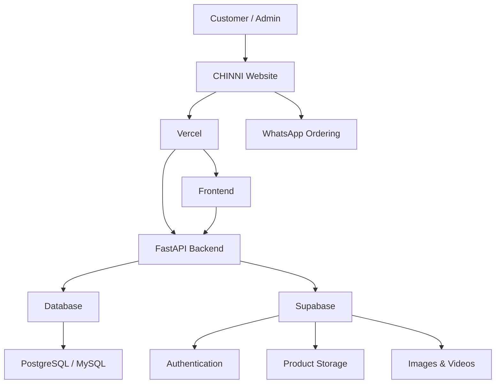

# 💎 CHINNI One Gram Gold

<p align="center">
  <b>A modern full-stack jewellery e-commerce platform for premium One Gram Gold collections.</b>
</p>

<p align="center">
  <a href="https://chinni.dpdns.org">
    
  </a>
  <a href="https://github.com/savanijaswanth20-wq/chinni_jewels">
    
  </a>
</p>

---

## 🌟 About The Project

**CHINNI One Gram Gold** is a full-stack jewellery e-commerce website built to provide customers with a clean, premium and mobile-friendly shopping experience.

The platform allows customers to explore jewellery collections, filter products by category, check product information and directly place orders through WhatsApp.

A dedicated **Admin Dashboard** allows the business owner to manage products, prices, categories, stock, images and other store content without modifying website code.

🌐 **Live Website:**  
https://chinni.dpdns.org

💻 **GitHub Repository:**  
https://github.com/savanijaswanth20-wq/chinni_jewels

---

## ✨ Features

### 🛍️ Customer Website

- Premium jewellery-focused user interface
- Fully responsive mobile and desktop design
- Dynamic product collection
- Category-based filtering
- Product images and details
- Product availability / stock information
- WhatsApp ordering integration
- Fast page loading
- Responsive navigation
- Product video support
- Autoplay jewellery campaign videos
- Mobile-friendly video carousel
- Smooth UI transitions and animations

### 💎 Jewellery Categories

- Necklaces
- Bangles
- Earrings
- Rings
- Chains
- Bridal Sets

### 🛠️ Admin Dashboard

- Secure Admin Dashboard
- Add new products
- Edit existing products
- Delete products
- Manage prices
- Manage product stock
- Manage categories
- Upload product images
- Manage jewellery videos
- Enable / disable products
- Update store information
- Centralized product management

### 💬 WhatsApp Ordering

Customers can directly contact the business through WhatsApp for:

- Product enquiries
- Orders
- Product availability
- Delivery details
- Customer support

---

## 🧰 Tech Stack

### Frontend

- HTML5
- CSS3
- JavaScript
- Vite
- Responsive Web Design

### Backend

- Python
- FastAPI
- Uvicorn
- SQLAlchemy
- Pydantic
- REST API

### Database

The project supports multiple database configurations:

- PostgreSQL
- Supabase PostgreSQL
- MySQL
- SQLite for local fallback

### Cloud & Storage

- Supabase
- Supabase Authentication
- Supabase Storage
- Vercel

### DevOps

- Docker
- Docker Compose
- Nginx
- Git
- GitHub
- Environment Variables
- Vercel Deployment
- Custom DNS / Domain

---

## 🏗️ Architecture



---

## 📁 Project Structure

```text
chinni_jewels/
│
├── frontend/
│   ├── package.json
│   └── ...
│
├── backend/
│   ├── app/
│   ├── main.py
│   ├── requirements.txt
│   ├── admin.html
│   ├── checkout.html
│   ├── index.html
│   └── Dockerfile
│
├── assets/
│
├── admin.html
├── Dockerfile
├── Dockerfile.frontend
├── docker-compose.yml
├── package.json
├── .env.example
└── README.md
```

---

## ⚙️ Environment Variables

Create a `.env` file from the provided example:

```bash
cp .env.example .env
```

Example configuration:

```env
PORT=8000
FRONTEND_PORT=8081
ENVIRONMENT=development

DATABASE_URL=your_database_connection_string

SUPABASE_URL=https://your-project.supabase.co
SUPABASE_ANON_KEY=your_supabase_anon_key
SUPABASE_PUBLISHABLE_KEY=your_publishable_key

JWT_SECRET_KEY=your_secure_secret

ADMIN_EMAIL=your_admin_email
ADMIN_PASSWORD=your_secure_admin_password

WHATSAPP_BUSINESS_NUMBER=your_whatsapp_number
```

> ⚠️ Never commit your real `.env`, database password, Supabase secret key or admin password to GitHub.

---

## 🚀 Run Locally

### 1. Clone the repository

```bash
git clone https://github.com/savanijaswanth20-wq/chinni_jewels.git
```

```bash
cd chinni_jewels
```

---

## 💻 Frontend Setup

Navigate to the frontend:

```bash
cd frontend
```

Install dependencies:

```bash
npm install
```

Start development server:

```bash
npm run dev
```

For production build:

```bash
npm run build
```

---

## ⚡ Backend Setup

Navigate to backend:

```bash
cd backend
```

Create a virtual environment:

### Windows

```bash
python -m venv venv
venv\Scripts\activate
```

### Linux / macOS

```bash
python3 -m venv venv
source venv/bin/activate
```

Install dependencies:

```bash
pip install -r requirements.txt
```

Run FastAPI:

```bash
uvicorn main:app --reload --host 0.0.0.0 --port 8000
```

Open API documentation:

```text
http://localhost:8000/docs
```

---

## 🐳 Docker Setup

This project includes Docker support.

Start the full application:

```bash
docker compose up --build
```

Default services:

```text
Frontend    → http://localhost:8081
Backend API → http://localhost:8000
PostgreSQL  → localhost:5433
```

Stop containers:

```bash
docker compose down
```

---

## 🐬 Optional MySQL Setup

The project also includes an optional MySQL Docker profile.

Start with MySQL:

```bash
docker compose --profile mysql up --build
```

Default MySQL host port:

```text
3307
```

---

## ☁️ Supabase Integration

Supabase can be used for:

- Authentication
- Product database
- Admin authentication
- Product images
- Jewellery videos
- Cloud storage
- Centralized product updates

Using centralized cloud storage ensures product changes can appear across different phones, laptops and other customer devices.

---

## 📦 Product Management Flow

```text
Admin Dashboard
      ↓
Add / Edit Product
      ↓
Select Category
      ↓
Upload Image / Video
      ↓
Save Product
      ↓
Database / Supabase
      ↓
Customer Website
```

Example:

```text
Product Name : Premium Gold Necklace
Category     : Necklace
Price        : ₹1,499
Stock        : Available
```

The product will then appear inside:

```text
ALL → NECKLACES
```

---

## 🎥 Product Video Experience

The collection section supports premium jewellery videos.

### Desktop

```text
┌────────────────┬──────────────────────┬────────────────┐
│ Product Video  │    The Collection    │ Product Video  │
│                │                      │                │
│   Necklace     │ Small in weight.     │    Bangles     │
│                │ Timeless in value.   │                │
└────────────────┴──────────────────────┴────────────────┘
```

### Mobile

```text
The Collection

[ Autoplay Jewellery Video ]

       ● ○ ○

Swipe ← → to explore
```

Videos can use:

```html
<video autoplay muted loop playsinline></video>
```

---

## 📱 Responsive Design

CHINNI One Gram Gold is designed for:

- Mobile phones
- Tablets
- Laptops
- Desktop computers

The UI automatically adapts product grids, category filters, navigation and multimedia content according to screen size.

---

## 🔐 Security

Important production practices used or recommended:

- Environment variables for credentials
- Supabase Row Level Security
- Protected Admin Dashboard
- JWT authentication
- Secure password handling
- Server-side database credentials
- No sensitive secrets inside frontend code
- `.env` excluded from Git

---

## 🌐 Deployment

### Production

The project is deployed using **Vercel** with a custom DNS/domain.

Live:

### 🔗 https://chinni.dpdns.org

Deployment flow:

```text
Local Development
      ↓
GitHub
      ↓
Vercel
      ↓
Custom Domain
      ↓
chinni.dpdns.org
```

Every production update can be pushed using:

```bash
git add .
git commit -m "Update Chinni Jewels"
git push origin main
```

---

## 🔮 Future Improvements

- Online payment gateway
- Order tracking
- Customer accounts
- Wishlist
- Shopping cart improvements
- Automated invoices
- Customer order history
- Product reviews
- Search functionality
- Advanced Admin analytics
- Sales dashboard
- Inventory alerts
- SEO improvements
- Progressive Web App support
- AI-powered jewellery recommendations
- Virtual jewellery try-on

---

## 🎯 Project Goal

The goal of this project is to build a real-world digital platform for a jewellery business rather than only creating a demonstration project.

The platform focuses on:

**Business usability • Customer experience • Responsive design • Product management • Cloud integration • Scalability**

---

## 👨‍💻 Developer

### Savvani Venkata Jaswanth

Software Developer focused on building practical full-stack applications and real-world business solutions.

GitHub:

https://github.com/savanijaswanth20-wq

---

## 🤝 Contributions

Suggestions, improvements and feedback are welcome.

If you find a bug or have an idea for improving the project, feel free to open an issue or submit a pull request.

---

<p align="center">
  <b>✨ CHINNI One Gram Gold ✨</b>
</p>

<p align="center">
  Small in weight. Timeless in value.
</p>

